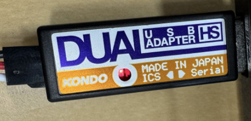

# rcb4


[](https://github.com/iory/rcb4/actions)

## Prerequisite

Linux users have to install `udev <https://en.wikipedia.org/wiki/Udev>`_ rules for rcb4 supported boards/devices. The latest version of the rules may be found at
https://github.com/iory/rcb4/tree/main/rcb4/assets/system/99-rcb4-udev.rules

This file must be placed at ``/etc/udev/rules.d/99-rcb4-udev.rules`` (preferred location) or ``/lib/udev/rules.d/99-rcb4-udev.rules`` (required on some broken systems).

Please open the system Terminal and type

```bash
curl -fsSL https://raw.githubusercontent.com/iory/rcb4/main/rcb4/assets/system/99-rcb4-udev.rules | sudo tee /etc/udev/rules.d/99-rcb4-udev.rules
sudo udevadm control --reload-rules
sudo udevadm trigger
```

Or you can manually download and copy the file to a destination folder

```bash
sudo cp 99-rcb4-udev.rules /etc/udev/rules.d/99-rcb4-udev.rules
sudo udevadm control --reload-rules
sudo udevadm trigger
```

Ubuntu/Debian users may need to add own “username” to the “dialout” group if they are not “root”, doing this issuing

```
sudo usermod -a -G dialout $USER
sudo usermod -a -G plugdev $USER
```

## Install

```bash
pip install rcb4
```

## Move servos from Python (RCB-4 / RCB-4mini)

Connect the board through a [Kondo Dual USB Adapter HS](https://kondo-robot.com/product/02116)
in serial mode (LED green). No HeartToHeart4 project is needed.

### First, from the terminal

```bash
rcb4-shell                 # or: rcb4-shell --port /dev/ttyUSB0
```

It finds the adapter, connects, prints every servo that answered and opens Python
(IPython if it is installed) with the board as `ri`:

```
 ICS  ID  SIO   angle[deg]  target[deg]  torque  moving
  32  16  1-4          0.0            -     off      no
  34  17  1-4          0.0            -     off      no
```

```python
ri.hold()                                    # torque on, where each servo is now -> [32, 34]
ri.angle_vector([15, -15], [32, 34], time=1.0)   # ICS 32 to 15 deg, ICS 34 to -15 deg, in 1 s
ri.wait_interpolation()                      # wait until the move has arrived -> True
ri.print_servos()
ri.neutral(time=1.0)                         # every servo to 0 deg
ri.wait_interpolation()
ri.free()                                    # torque off
```

### In a script

```python
from rcb4.rcb4interface import RCB4Interface

ri = RCB4Interface()
ri.auto_open()            # or ri.open(port="/dev/ttyUSB0")
ids = ri.search_servo_ids()
print(ids, ri.angle_vector())

ri.hold(ids)
ri.angle_vector([30] * len(ids), ids, time=2.0)
ri.wait_interpolation()
ri.free(ids)
```

| Call | What it does |
|------|--------------|
| `search_servo_ids()` | ICS numbers of the servos found at connect |
| `angle_vector()` / `angle_vector(servo_ids=ids)` | current angles [deg] |
| `angle_vector(av, ids, time=t)` | move to `av` [deg] in `t` s (or `velocity=` output cycles) |
| `wait_interpolation(ids, timeout=None)` | wait until the moves have arrived; False on timeout |
| `interpolating_servo_ids(ids)` | the ones still moving |
| `reference_angle_vector(ids)` | the targets, in servo units |
| `hold(ids)` / `free(ids)` | torque on (in place) / off |
| `neutral(ids, time=t)` | to 0 deg |
| `send_stretch(value, ids)` | holding stiffness, 1-127 (one value, or one per servo) |
| `print_servos(ids)` | a table of angle, target, torque and moving |

Things to know:

- **Servos are named by ICS number** = 2 x servo ID + port: even numbers are on
  SIO1-4, odd numbers on SIO5-8. `print_servos()` shows both.
- **A free servo does not move.** `angle_vector` skips it and says so; `hold()` it
  first.
- `angle_vector(av, ...)`, `neutral`, `hold` and `free` return the ICS numbers they
  commanded (`[]` when every servo was free), and raise `serial.SerialException`
  if the board does not acknowledge.
- **`angle_vector(av, ...)` returns at once**: the board moves the servos over
  `time`. Call `wait_interpolation()` before the next move, or the next one
  replaces it. A servo that is blocked (gripping, at a stop) counts as arrived; compare
  `angle_vector()` with the target to find it.
- `time` is rounded to output cycles of 15 ms and can be at most 3.8 s (255 cycles);
  `velocity=` gives the cycles directly (127 = 1.9 s).
- **Servos are found once, at connect.** One plugged in later is not seen until
  you connect again.
- `open()` runs the board flat by default (see [rcb4-rom](#rcb-4-board-rom-rcb4-rom)):
  any project in its ROM is ignored, so the zeros are the servos' own.

## Write firmware

Connect st-link and run the following command.

```bash
rcb4-write-firmware
```

## Change Servo ID (ics-manager)

The `ics-manager` command allows you to change servo IDs and configure servo parameters.

### Requirements

- [Kondo Dual USB Adapter HS](https://kondo-robot.com/product/02116)
- ICS servo (KRS series, etc.)

### Setup

1. **Set the Dual USB Adapter to ICS mode**

   Switch the mode selector on the Dual USB Adapter to ICS mode. When properly set, the LED will light up red.

   

2. **Connect only ONE servo at a time**

   ⚠️ **Important**: Connect only one servo when changing IDs. If multiple servos are connected, all of them will have their IDs changed simultaneously, which can cause conflicts.

### Platform Support

- **Linux**: Works out of the box after installing udev rules (see Prerequisite section)
- **macOS**: Supported via pyftdi (automatically installed)

### Usage

```bash
ics-manager
```

The interactive interface allows you to:
- View current servo ID
- Change servo ID using arrow keys (←→) and Enter to confirm
- Adjust servo angle, speed, and stretch parameters
- Toggle rotation mode (for continuous rotation servos)
- Toggle reverse mode (invert the rotation direction)
- Toggle free mode (disable servo holding torque)
- Reset servo position

#### Keyboard Controls

| Key | Action |
|-----|--------|
| ↑↓ | Navigate between options |
| ←→ | Adjust selected value |
| Enter | Confirm servo ID change |
| z | Reset servo to zero position |
| r | Toggle rotation mode |
| v | Toggle reverse mode (frees the servo first) |
| f | Toggle free mode |
| d | Reset to default EEPROM parameters |
| q | Quit |

## RCB-4 board ROM (rcb4-rom)

A HeartToHeart4 project in an RCB-4 / RCB-4mini's ROM moves the servos at power-up
(hold, home position, startup motion) and sets trim and mixing that shift what the
servos are driven to. `RCB4Interface.open()` undoes all of that in RAM at every
connect (`flat=True`, the default). `rcb4-rom` makes it persistent, so the board
powers up without commanding any servo:

```bash
rcb4-rom show                  # what the board does at power-up
rcb4-rom flat-startup          # backs the ROM up to rcb4-rom-<date>.bin, then writes it
rcb4-rom restore rcb4-rom-<date>.bin   # put the project back
rcb4-rom backup rom.bin
```

`flat-startup` turns the ROM program off in the startup config (the startup routine
then stops right after writing it, before holding or moving any servo) and makes every
servo record start free, with no trim and no mixing. The green LED is lit from power-up
(`--no-led` to leave it off). The COM and ICS baud rates and the
ICS table are kept. Pass `--port` to pick the adapter.

`rcb4-rom flat-startup --blink 3` also blinks the green LED 3 times (0.3 s on, 0.3 s
off) at power-up and then leaves it on, so a flat board can be told by eye (at most 3
blinks fit in place of the startup code it replaces). The ROM program runs during the
blinks, about 2 s; `rcb4-rom show` reports the blink count.

## Contributing

### Automatic Formatting
This repository uses `ruff` for both linting and formatting which is configured in `pyproject.toml`, you can run with:
```
pip install ruff
ruff format
ruff check --fix .
```

### Clang-Format
To install `clang-format`, you can use the following command:
```
pip install clang-format
```

Once installed, you can format your files using a `.clang-format` configuration file. To format a file, run:
```
clang-format -i <filename>
```

Replace `<filename>` with the name of the file you want to format. The `-i` option tells `clang-format` to edit the file in place.

## For JSK Users

### Worm Gear Module Calibration Tool

`armh7-tools` provides a comprehensive solution for calibrating and managing worm gear modules connected via the `ARMH7Interface`.
It facilitates the calibration of worm gears, reading of calibrated sensor data, and real-time display of sensor and worm gear values.
Designed for flexibility, it supports operations like calibration data update and in-place modification of YAML configuration files.

#### YAML Configuration Format

The calibration tool requires an input YAML file for worm gear modules configuration. 
This file contains a list of worm gears with their associated parameters: `worm_id`, `servo_id`, `sensor_id`,
and initial magnetic encoder value `magenc_init`.
Each worm gear is represented by a line in the YAML file with its parameters encapsulated in curly braces and prefixed by a dash, indicating a list item in YAML syntax.

```
 - {worm_id: 0, servo_id: 0, sensor_id: 38, magenc_init: 6502}
 - {worm_id: 1, servo_id: 2, sensor_id: 40, magenc_init: 3039}
 - {worm_id: 3, servo_id: 6, sensor_id: 44, magenc_init: 9502}
```

#### Reading Worm Gear Modules's calibration data

```
armh7-tools read-calib [--device DEVICE] output_file_path
```

`--device`, `-d`: Specify the device port. (Default: None)
`output_file_path`: Path to output the YAML file with calibration data.


##### Example

```
armh7-tools read-calib ./worm_calib.yaml
```

#### Calibrate Worm Gear Modules

```
armh7-tools calibrate [--device DEVICE] file_path [--inplace] [--update] [--output OUTPUT]
```

`--device`, `-d`: Specify the device port. (Default: None)
`file_path`: Path to the input YAML file containing worm gear configurations.
`--inplace`, `-i`: Overwrite the input YAML file with calibration results. (Optional)
`--update`, `-u`: Ignore and overwrite the current magenc_init values in the input YAML. (Optional)
`--output`, `-o`: Specify a path to save the calibrated data if not overwriting in-place. (Optional)

##### Example

When the `update` option is specified, the current posture of the robot will be modified, 
and upon pressing the Enter key, the angle at that moment will be set as the zero point. 
Consequently, the `magenc_init` value will be updated and written to the board, 

```
armh7-tools calibrate ./worm_calib.yaml --update
```

#### Print Sensor Values

This command displays real-time sensor values in a table format.

```
armh7-tools print-sensor
+------|----------|--------------|--------------|--------------|--------------|----------|----------|----------|----------+
|   ID |   Magenc |   Proximity1 |   Proximity2 |   Proximity3 |   Proximity4 |   Force1 |   Force2 |   Force3 |   Force4 |
|------|----------|--------------|--------------|--------------|--------------|----------|----------|----------|----------|
|   19 |     7365 |            0 |            0 |            0 |            0 |     1240 |     1167 |     1083 |     1037 |
|   20 |     3042 |            0 |            0 |            0 |            0 |     1209 |     1106 |     1075 |     1025 |
|   21 |    13800 |            0 |            0 |            0 |            0 |     1230 |     1106 |     1064 |     1003 |
|   22 |     9512 |            0 |            0 |            0 |            0 |     1222 |     1144 |     1123 |     1085 |
|   23 |    14182 |            0 |            0 |            0 |            0 |     1238 |     1179 |     1083 |     1040 |
+------|----------|--------------|--------------|--------------|--------------|----------|----------|----------|----------+
```

#### Print Worm Values

Displays real-time worm gear values in a table format.

```
armh7-tools print-worm
+------------|-------------|---------------|------------------|-----------------+
|   servo_id |   sensor_id |   magenc_init |   magenc_present |   present_angle |
|------------|-------------|---------------|------------------|-----------------|
|          0 |          38 |          6502 |             7368 |      -19.0283   |
|          2 |          40 |          3039 |             3039 |       -0        |
|          6 |          44 |          9502 |             9513 |       -0.241699 |
|          8 |          46 |          9783 |            14170 |      -96.394    |
+------------|-------------|---------------|------------------|-----------------+
```
